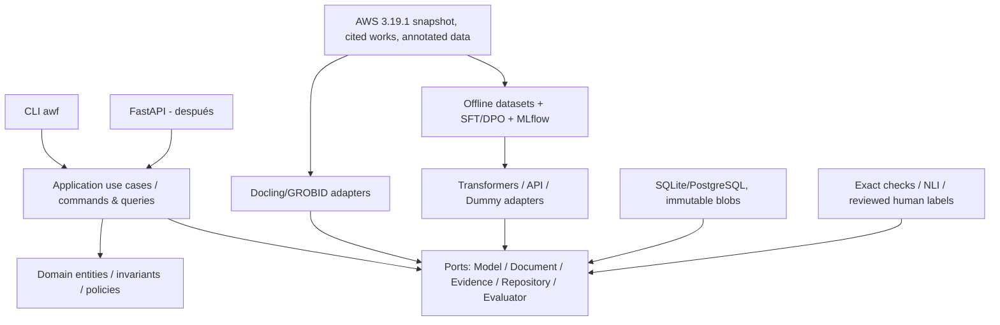

# Academic Writing Forge (AWF) · AWF Neural Engine

**Especificación de arquitectura, desarrollo y transferencia entre agentes**  
**Estado:** propuesta verificable, aún sin implementación del producto · **Fecha:** 2026-10-17  
**Documento de referencia:** este archivo prevalece para la arquitectura nueva; la suite anterior es una fuente, no un controlador de desarrollo.  
**Baseline preservado:** `academic_writing_suite_v3_19_1_product(1).zip` (no modificar, conservar SHA256, licencia y procedencia).  
**Paquete Python:** `awf` · **Repositorio:** `academic-writing-forge` · **CLI:** `awf`.

## 0. Alcance y exclusiones explícitas

**Misión.** Construir un sistema de revisión académica que edite de forma controlada textos ES/EN manteniendo propósito, significado, fuentes, citas y decisiones del autor. Aprender operaciones lingüísticas mediante modelos neuronales ajustables, sin dejar que un modelo autovalide su propio output.

**No objetivos del MVP:** prometer una puntuación frente a Turnitin/Pangram/GPTZero; publicar un editor web completo; preentrenar pesos desde cero; integrar indiscriminadamente 184 reglas como prompts; crear infraestructura de microservicios; reemplazar evidencia de terceros por una métrica propia de «humanidad».

**Definiciones:**
- **Modelo base:** red neuronal Transformer descargable como Qwen3 o modelo de edición mEdIT.
- **Modelo propio:** pesos del modelo base más adaptador(es) AWF entrenados y versionados, o, si estuviera plenamente justificado, modelo completo fine-tuned.
- **Código determinista:** valida estados, tipos, hashes, conjuntos protegidos, versiones y cumplimiento formal; nunca afirma inferencias científicas sin evidencia.
- **Validador probabilístico:** produce observación calibrable, con margen de incertidumbre y trazabilidad; no concede PASS por sí mismo.
- **Holdout:** dato sellado y no accesible al proceso de selección de modelos, prompts y políticas.
- **Regla de conocimiento:** unidad tipada con ID estable, soporte/contradicciones, condiciones, excepciones, clasificación de uso y pruebas.

## 1. Decisiones de arquitectura (ADRs)

| ADR | Decisión vinculante | Alternativa descartada / motivo | Condición de revisión |
|---|---|---|---|
| 001 | **Monolito modular Python con hexagonal/ports & adapters** | Microservicios: redes, contratos remotos y observabilidad prematura | Tráfico/equipos/aislamiento operativo justifican despliegues independientes |
| 002 | **Dominio separado de frameworks** | Domain models acoplados a Pydantic/FastAPI/Transformers | Solo por ADR documentada y test de impacto |
| 003 | **Modelo neuronal preentrenado, adaptadores PEFT** | Entrenamiento Transformer desde cero sin corpus/cómputo pretraining | Experimento demuestra necesidad de nuevo preentrenamiento |
| 004 | **SFT después del baseline, DPO solo con preferencias revisadas** | RL/PPO desde Sprint 1, recompensas no validadas | Dataset y judge calibrado + ablation favorable |
| 005 | **Políticas críticas ejecutables / semántica con incertidumbre** | `"semantic_preservation":"PASS"` autodeclarado por un LLM | Nunca relajar para score detector |
| 006 | **Knowledge compiler conserva canonical raw** | Copiar las 184 reglas a prompt o embeddings sin estado/autoridad | Solo desactivar vía ablación documentada, sin borrar corpus |
| 007 | **SQLite + SQLAlchemy/Alembic para metadata inicial, blobs por hash** | Postgres/Redis/Kafka antes de tener múltiples procesos | Migrar PostgreSQL cambiando configuración de repositorio, no dominio |
| 008 | **Git + uv.lock + DVC para datasets crecientes + MLflow para runs** | Pesos/datasets grandes en Git; hojas de cálculo como tracking | DVC puede activarse al cruzar umbral de tamaños/licencias |
| 009 | **CLI en S1, API FastAPI después; NO web en MVP** | UI a costa de pruebas y datos reproducibles | API en sprint de integración, frontend tras necesidad de usuarios |
| 010 | **CQRS ligero de comandos/consultas en aplicación; no event sourcing** | Doble base de datos, event bus, eventual consistency | Carga de lectura vs escritura demostrablemente desigual |
| 011 | **Protocolo `ModelPort`; backend dummy, Transformers y API opcional** | Dependencia irreversible de Gemini/Qwen | Pruebas de contrato idénticas para todos los adaptadores |
| 012 | **Prioridad científica: fidelidad, fuentes, calidad humana, seguridad; detector secundario** | Entrenar contra una proxy AI score y suponer calidad | Nunca sustituir métricas primarias por detector |
| 013 | **Un repositorio, versiones semánticas separadas por artefacto** | Múltiples repos sin necesidad de equipos independientes | Dividir cuando existan distintas cadencias/owners de deploy |
| 014 | **ES/EN separados en evaluación; mixed record explícito** | Extrapolar resultados ingleses a español | Transferencia respaldada en mismo snapshot y benchmark |
| 015 | **Idempotencia en ingestión; contenido original inmutable** | Editar DOCX fuente in place | No revisable; regla de integridad |

**Relaciones de dependencia:** `domain` → ninguna biblioteca externa relevante; `application` → `domain` + puertos; `adapters` → application/domain + servicios externos; `entrypoints` → application + adapters (composition root). Ninguna capa interna importa `fastapi`, `transformers`, `torch`, `sqlalchemy`, `docling` ni `mlflow`.

**CQRS exacto:** los comandos `ingest_document`, `compile_knowledge`, `propose_revision`, `verify_candidate`, `accept_revision`, `register_annotation` cambian estado; las consultas `get_document`, `get_revision_diff`, `list_findings`, `get_experiment_report` leen. Ambos comparten una base relacional al inicio, sin duplicación ni consistencia eventual. No implementar eventos de dominio persistidos salvo exigencia empírica. La cadena de linaje (`revision.parent_id`) no es event sourcing.

## 2. Arquitectura lógica por capas y flujo



**Flujo de revisión (síncrono MVP):**

```text
Ingest file → parse to DocumentIR → protect original bytes + hash
→ extract anchors: citation, number, term, paragraph ID
→ load scoped KnowledgeItems and source cards
→ plan EditContract → ModelPort.generate_candidates(N=1 initially)
→ deterministic invariant check → semantic/source evaluators (tri-state)
→ candidate status {ACCEPTABLE, REJECTED, NEEDS_REVIEW}
→ explicit user approval → immutable Revision + diff + receipt
→ optionally export derivative DOCX/Markdown (original untouched)
```

**Estados:** `CREATED`, `INGESTED`, `PLANNED`, `GENERATED`, `CHECKED`, `ACCEPTED`, `REJECTED`, `NEEDS_REVIEW`. Transiciones explícitas y registradas con `run_id`; una interrupción jamás produce ACCEPTED de forma implícita.

**Semántica triestado:** `PASS | FAIL | UNKNOWN` para checks automáticos, y `HUMAN_CONFIRMED` como confirmación independiente. `UNKNOWN` crítico bloquea autoaceptación. Prohibido equivaler ausencia de finding con PASS.

## 3. Árbol exacto previsto del repositorio

Los archivos se crean según el sprint indicado en el catálogo de responsabilidades. No se deben crear archivos vacíos ni `__init__.py` ficticios solo para inflar el proyecto. Las carpetas `interfaces` y `adapters` expresan puertos y adaptadores; `application` contiene use cases; `domain` expresa negocio sin proveedor. En esta versión se reserva el nombre de los archivos para estabilizar las transferencias entre chats.

```text
academic-writing-forge/
├── README.md
├── AGENTS.md
├── CONTRIBUTING.md
├── LICENSE
├── SECURITY.md
├── CHANGELOG.md
├── pyproject.toml
├── uv.lock                         # generado por uv, commit
├── .python-version
├── .gitignore
├── .env.example
├── Makefile
├── Dockerfile                     # cuando haya backend/API
├── docker-compose.yml             # cuando se necesite Postgres local
├── .github/
│   ├── CODEOWNERS
│   ├── pull_request_template.md
│   └── workflows/
│       ├── ci.yml
│       ├── security.yml
│       └── release.yml
├── docs/
│   ├── PROJECT_CHARTER.md
│   ├── PRODUCT_SCOPE.md
│   ├── ARCHITECTURE.md
│   ├── DATA_GOVERNANCE.md
│   ├── MODEL_AND_DATA_POLICY.md
│   ├── VALIDATION_PROTOCOL.md
│   ├── REPRODUCIBILITY.md
│   ├── DEVELOPER_GUIDE.md
│   ├── AGENT_HANDOFF.md
│   ├── REQUIREMENT_TRACEABILITY.md
│   ├── SOURCE_REGISTRY.md
│   ├── adr/
│   │   ├── 0001-modular-monolith-hexagonal.md
│   │   ├── 0002-pretrained-peft-vs-scratch.md
│   │   ├── 0003-data-and-model-governance.md
│   │   ├── 0004-evaluation-independent-gates.md
│   │   └── 0005-storage-and-cqrs-lite.md
│   └── contracts/
│       ├── document-ir.schema.json
│       ├── knowledge-item.schema.json
│       ├── edit-contract.schema.json
│       ├── validation-receipt.schema.json
│       ├── edit-example.schema.json
│       ├── preference-pair.schema.json
│       └── experiment-manifest.schema.json
├── configs/
│   ├── application.yaml
│   ├── models/
│   │   ├── dummy.yaml
│   │   ├── qwen3-4b.yaml
│   │   └── external-api.yaml.example
│   ├── training/
│   │   ├── sft-pilot.yaml
│   │   └── dpo-pilot.yaml
│   └── evaluation/
│       ├── benchmark-v1.yaml
│       └── gates-v1.yaml
├── provenance/
│   ├── source-manifest.json        # contains sha, path, provenance, license; no secret data
│   └── upstream-checksums.sha256
├── data/
│   ├── README.md
│   ├── source-catalog.yaml
│   ├── schemas/
│   │   ├── edit-example.schema.json
│   │   └── preference-pair.schema.json
│   ├── manifests/
│   │   ├── initial-sources.yaml
│   │   └── split-v1.yaml
│   ├── raw/.gitkeep                # raw content not tracked
│   ├── interim/.gitkeep
│   ├── processed/.gitkeep
│   └── holdout/.gitkeep            # protected and not consumed by training
├── src/awf/
│   ├── __init__.py
│   ├── domain/
│   │   ├── __init__.py
│   │   ├── identifiers.py
│   │   ├── document.py
│   │   ├── knowledge.py
│   │   ├── edit.py
│   │   ├── evidence.py
│   │   ├── validation.py
│   │   ├── errors.py
│   │   └── policies.py
│   ├── application/
│   │   ├── __init__.py
│   │   ├── dto.py
│   │   ├── ports.py
│   │   ├── services.py
│   │   ├── commands/
│   │   │   ├── ingest_document.py
│   │   │   ├── compile_knowledge.py
│   │   │   ├── propose_revision.py
│   │   │   ├── verify_candidate.py
│   │   │   ├── accept_revision.py
│   │   │   └── register_annotation.py
│   │   └── queries/
│   │       ├── get_document.py
│   │       ├── get_revision.py
│   │       ├── list_findings.py
│   │       └── get_experiment_report.py
│   ├── knowledge/
│   │   ├── __init__.py
│   │   ├── compiler.py
│   │   ├── classify.py
│   │   ├── applicability.py
│   │   ├── contradictions.py
│   │   └── dependency_graph.py
│   ├── editing/
│   │   ├── __init__.py
│   │   ├── planner.py
│   │   ├── candidate_generator.py
│   │   ├── diff.py
│   │   └── patch.py
│   ├── verification/
│   │   ├── __init__.py
│   │   ├── exact_checks.py
│   │   ├── number_checks.py
│   │   ├── citation_checks.py
│   │   ├── semantic_checks.py
│   │   ├── source_grounding.py
│   │   ├── adjudicator.py
│   │   └── calibration.py
│   ├── adapters/
│   │   ├── __init__.py
│   │   ├── document/
│   │   │   ├── markdown_adapter.py
│   │   │   ├── docx_adapter.py
│   │   │   └── pdf_adapter.py
│   │   ├── models/
│   │   │   ├── dummy_model.py
│   │   │   ├── transformers_model.py
│   │   │   └── external_llm.py
│   │   ├── persistence/
│   │   │   ├── sqlalchemy_models.py
│   │   │   ├── sqlalchemy_repository.py
│   │   │   ├── migrations.py
│   │   │   └── blob_store.py
│   │   ├── evidence/
│   │   │   ├── file_source_repository.py
│   │   │   └── citation_resolver.py
│   │   └── evaluation/
│   │       ├── nli_evaluator.py
│   │       └── human_annotation_repository.py
│   ├── ml/
│   │   ├── __init__.py
│   │   ├── dataset_builder.py
│   │   ├── licensing.py
│   │   ├── deduplication.py
│   │   ├── split.py
│   │   ├── train_sft.py
│   │   ├── train_dpo.py
│   │   ├── model_registry.py
│   │   └── experiment_tracking.py
│   ├── evaluation/
│   │   ├── __init__.py
│   │   ├── baseline_runner.py
│   │   ├── benchmark_runner.py
│   │   ├── ablation_runner.py
│   │   ├── metrics.py
│   │   └── statistics.py
│   ├── cli/
│   │   ├── __init__.py
│   │   └── main.py
│   └── api/                      # sprint avanzado, no desde el día 1
│       ├── __init__.py
│       ├── app.py
│       ├── dependencies.py
│       ├── schemas.py
│       └── routes/
│           ├── documents.py
│           ├── revisions.py
│           └── experiments.py
├── migrations/
│   ├── env.py
│   ├── script.py.mako
│   └── versions/
├── tests/
│   ├── conftest.py
│   ├── fixtures/
│   │   ├── academic_paragraphs.json
│   │   ├── drift_cases.json
│   │   └── citation_cases.json
│   ├── unit/
│   │   ├── test_domain_models.py
│   │   ├── test_knowledge_compiler.py
│   │   ├── test_applicability.py
│   │   ├── test_exact_checks.py
│   │   ├── test_citation_checks.py
│   │   ├── test_split_leakage.py
│   │   └── test_adjudicator.py
│   ├── contract/
│   │   ├── test_model_port.py
│   │   ├── test_document_port.py
│   │   └── test_repository_port.py
│   ├── integration/
│   │   ├── test_ingest_to_ir.py
│   │   ├── test_revise_and_verify.py
│   │   ├── test_sqlite_repository.py
│   │   └── test_cli.py
│   ├── property/
│   │   ├── test_revision_immutability.py
│   │   └── test_idempotent_ingestion.py
│   ├── metamorphic/
│   │   └── test_semantic_boundary_mutations.py
│   └── regression/
│       ├── test_aws_cases.py
│       └── test_gold_cases.py
├── scripts/
│   ├── import_aws_3191.py
│   ├── validate_dataset.py
│   ├── generate_manifest.py
│   └── smoke_test.py
├── models/
│   ├── README.md                 # manifests, configs, adapter pointers only
│   └── .gitkeep
└── reports/
    └── .gitkeep                 # generated results ignored by Git
```

## 4. Responsabilidad de archivos: dominio y aplicación

| Archivo(s) | Responsabilidad exclusiva | Qué no debe hacer |
|---|---|---|
| `domain/identifiers.py` | `DocumentId`, `RevisionId`, `KnowledgeId`, `RunId`; UUID/typing | Referencias a rutas locales, SQL ni GPU |
| `domain/document.py` | `Document`, `DocumentIR`, `Paragraph`, `Span`, `DocumentVersion` | Parsear bytes o modificar originales |
| `domain/knowledge.py` | `KnowledgeItem`, `EvidenceGrade`, `Applicability`, `KnowledgeDecision` | Importar PDFs o inferir utilidad por frecuencia |
| `domain/edit.py` | `EditContract`, `Candidate`, `Revision`, `EditOperation` | Llamar LLM y aceptar resultados por score |
| `domain/evidence.py` | `SourceReference`, `CitationAnchor`, `ClaimEvidenceLink` | Descargar web, inventar citas |
| `domain/validation.py` | `Finding`, `CheckResult`, `Decision`, enums triestado | Autodeclarar semántica aprobada |
| `domain/errors.py` | Excepciones de dominio tipadas (`UnverifiedSource`, `InvalidTransition`) | Excepciones de proveedor HTTP/GPU |
| `domain/policies.py` | Predicados puros para transición/aceptación | Lógica estadística/LLM opaca |
| `application/dto.py` | Request/result tipados independientes de FastAPI | Persistencia y modelos ORM |
| `application/ports.py` | Protocolos `DocumentParserPort`, `ModelPort`, `DocumentRepositoryPort`, `EvidencePort`, `SemanticEvaluatorPort`, `ClockPort` | Instanciación directa de adapters |
| `application/services.py` | `RevisionService` compone use cases/transacciones | Hacer consultas SQL ni cargar CUDA |
| `application/commands/ingest_document.py` | Validar entrada, producir IR, hashes y metadata | Editar el archivo original |
| `application/commands/compile_knowledge.py` | Disponer cada regla/importación con auditoría | Entrenar automáticamente con ellas |
| `application/commands/propose_revision.py` | Contrato→candidatos y linaje | Marcar candidatos ACCEPTED |
| `application/commands/verify_candidate.py` | Ejecutar cascade exacto/semántico/fuente | Equivaler score NLI con verdad garantizada |
| `application/commands/accept_revision.py` | Confirmar gates críticos, aprobar, persistir revisión | Omitir el consentimiento/aprobación requerido |
| `application/commands/register_annotation.py` | Registrar gold labels y desacuerdo humano | Mezclar holdout con training |
| `application/queries/*` | DTOs solo lectura y filtrado | Mutar estado ni emitir acciones ocultas |

## 5. Responsabilidad de archivos: conocimiento, edición y verificación

| Archivo | Responsabilidad | Contrato mínimo |
|---|---|---|
| `knowledge/compiler.py` | Convertir la fuente AWS inmutable a candidatos `KnowledgeItem` | Input snapshot+manifest; output registry versionado, sin inferir PASS automático |
| `knowledge/classify.py` | Proponer `KEEP_AS_CODE`, `KEEP_AS_CONTEXT`, `TRAIN`, `EVAL_ONLY`, `REMOVE_FROM_ACTIVE` | Registra razón/confianza; las clasificaciones riesgosas exigen revisión |
| `knowledge/applicability.py` | Evaluar lenguaje, sección, contexto, alcance y excepciones | Devuelve `APPLICABLE`, `NOT_APPLICABLE`, `UNKNOWN` |
| `knowledge/contradictions.py` | Detectar soporte/contradicción de reglas por ID y contexto | Nunca latest-wins ni borrar evidencia |
| `knowledge/dependency_graph.py` | Cierre transitivo de prerequisitos/invalidación | Ciclos y rutas ausentes producen error tipado |
| `editing/planner.py` | Traducir intención del usuario a un `EditContract` | Declara claims/protected spans/allowed operations |
| `editing/candidate_generator.py` | Llamar `ModelPort` con contrato inmutable; N=1 piloto | No decide aceptación ni guarda claves |
| `editing/diff.py` | Diff a nivel span/paragraph; operar sobre offsets de DocumentIR | No reconstruir fuente/citas por conjetura |
| `editing/patch.py` | Aplicar patch validado a nueva versión del IR | Nunca modificar input baseline |
| `verification/exact_checks.py` | Hashes, IDs, nombres protegidos, fechas/citas exactas | No dictaminar paráfrasis semántica |
| `verification/number_checks.py` | Números, unidades, porcentajes y comparadores congelados | No decidir por sí solo si cambio de cifra estaba autorizado |
| `verification/citation_checks.py` | Identidad y anclajes de referencias/citas | No suponer que toda cita respalda el claim |
| `verification/semantic_checks.py` | Invocar NLI/evaluador contra input/candidato/sources | Triestado; métricas de calibración |
| `verification/source_grounding.py` | Comparar claims y fragmentos de evidencia | Fuente ausente→UNKNOWN/FAIL según política |
| `verification/adjudicator.py` | Combinar gates según precedencia; generar decisión | Nunca promedio ponderado que compense FAIL crítico |
| `verification/calibration.py` | Umbrales y confiabilidad del evaluator en gold externo | No ajustar parámetros usando holdout sellado |

## 6. Responsabilidad de archivos: adaptadores, ML, evaluación y entrypoints

| Archivo | Responsabilidad | Sprint de activación |
|---|---|---|
| `adapters/document/markdown_adapter.py` | Parse MD preservando encabezados, refs/offsets | S1 |
| `adapters/document/docx_adapter.py` | DOCX→IR manteniendo estilos/citas cuando sea posible | S3 |
| `adapters/document/pdf_adapter.py` | PDF→IR por Docling, GROBID opcional | S3 |
| `adapters/models/dummy_model.py` | Candidato reproducible para pruebas; no IA | S1 |
| `adapters/models/transformers_model.py` | Transformers/Qwen/mEdIT, config y versionado | S4 |
| `adapters/models/external_llm.py` | Gemini/otras APIs opt-in con timeout y redacción | S4 opcional |
| `adapters/persistence/sqlalchemy_models.py` | Mapping ORM metadata; sin semántica de dominio | S2 |
| `adapters/persistence/sqlalchemy_repository.py` | Implementar repositorios transaccionales | S2 |
| `adapters/persistence/migrations.py`, `migrations/*` | Evolución reversible de esquema | S2 |
| `adapters/persistence/blob_store.py` | Guardar originales/derivados por SHA256 y acceso controlado | S2 |
| `adapters/evidence/file_source_repository.py` | Cargar fuentes permitidas desde filesystem/IR | S3 |
| `adapters/evidence/citation_resolver.py` | Resolver referencias sin inventar contenido | S3 |
| `adapters/evaluation/nli_evaluator.py` | Implementación de semantic evaluator | S3 |
| `adapters/evaluation/human_annotation_repository.py` | Entradas de evaluaciones ciegas/anotación gold | S3 |
| `ml/dataset_builder.py` | Ejemplos SFT tipados; no mutación de gold | S4 |
| `ml/licensing.py` | Comprobar permisos y restricciones por dataset | S2 |
| `ml/deduplication.py` | DOI/título/proveniencia + fingerprint near-duplicate | S2 |
| `ml/split.py` | Split por documento/autor/grupo de fuente | S2 |
| `ml/train_sft.py` | PEFT/TRL SFT con configuración, datos versionados | S5 |
| `ml/train_dpo.py` | DPO solo con pairs elegibles | S6 condicional |
| `ml/model_registry.py` | Fijar modelo+revision+tokenizer+adapter | S4 |
| `ml/experiment_tracking.py` | Runs, métricas, artefactos a MLflow | S4 |
| `evaluation/baseline_runner.py` | Comparaciones B0-B4 reproducibles | S4 |
| `evaluation/benchmark_runner.py` | Evaluación sistemática con holdout externo | S3/S4 |
| `evaluation/ablation_runner.py` | Retirar una familia/función y comparar | S6 |
| `evaluation/metrics.py` | Métricas definidas y dirección de optimización | S3 |
| `evaluation/statistics.py` | Bootstrap por documento y CIs | S3 |
| `cli/main.py` | Comandos Typer; parsea opciones y compone adapters | S1 |
| `api/app.py`, `dependencies.py`, `schemas.py`, `routes/*` | HTTP transport/DTO, dependency injection y errores | S7 |

## 7. Contratos de datos y ejemplos exactos

### 7.1 `EditContract` (v1)

```json
{
  "contract_version": "1.0.0",
  "document_id": "doc-001",
  "revision_parent_sha256": "<sha256-original>",
  "language": "es",
  "task": "improve_academic_coherence",
  "scope": ["paragraph:p12"],
  "applicable_knowledge_ids": ["OP-CLAUSE-001"],
  "protected_tokens": [{"value":"18 %", "reason":"observed_metric"}, {"value":"DOI:10.x", "reason":"citation_identity"}],
  "source_anchors": [{"source_id":"src-001", "span":"methods:p4"}],
  "allowed_operations": ["OP-CLAUSE-001"],
  "forbidden_changes": ["quantity", "causal_force", "population_scope", "citation_attribution"],
  "require_human_approval": true
}
```

Un valor `sha256` ilustrativo de la especificación **no** es evidencia real. El runtime debe calcularlo a partir de bytes, y un schema debe exigir el patrón exacto `[0-9a-f]{64}` para hashes persistidos.

### 7.2 `CheckResult` y precedencia

```json
{
  "checker_id": "citation_identity:v1",
  "input_sha256": "<sha256>",
  "candidate_sha256": "<sha256>",
  "status": "PASS",
  "severity": "CRITICAL",
  "evidence_refs": ["protected-token-12"],
  "confidence": null,
  "reason_code": "CITATIONS_UNCHANGED",
  "details": "All protected citation identifiers preserved"
}
```

- Un `FAIL` de prioridad crítica → `REJECTED`.
- Un `UNKNOWN` crítico → `NEEDS_REVIEW`.
- Un `PASS` crítico requiere comprobación real que evalúe texto/artefactos; está prohibido aceptar `PASS` suministrado por el mismo generador como prueba.
- Un `WARN` no crítico puede producir `NEEDS_REVIEW` según política, nunca ocultarse.
- Las confirmaciones humanas deben enlazarse al mismo hash y al hallazgo preciso.

### 7.3 Registros SFT y preferencias

```json
{
  "example_id": "sft-000001",
  "source_group_id": "group-001",
  "document_id": "doc-001",
  "language": "es",
  "task": "fix_academic_coherence",
  "instruction": "Mejora la cohesión conservando claims y citas",
  "input_text": "...",
  "target_text": "...",
  "source_context_ids": ["src-001"],
  "permission": "TRAIN_ALLOWED",
  "annotation_provenance": "human_reviewed",
  "split": "train",
  "schema_version": "1.0.0"
}
```

Preferencia DPO: `{prompt, chosen, rejected, document_group_id, annotator_id, rationale, chosen_checks, rejected_checks, permission, split}`. Generar sólo si dos candidatos son comparables y no existe drift no autorizado en `chosen`. No exponer identidad personal del anotador en datasets exportados.

## 8. Dataset strategy: fuentes y política

### 8.1 Fuentes candidatas a inspeccionar (no autoaprobadas)

1. **AWS 3.19.1**: corpus normativo/regresión; no es un dataset grande de SFT. `54` casos deberían permanecer primariamente en `EVAL_ONLY` o evaluaciones de precondiciones.
2. **CoEdIT (EMNLP 2023)**: paper reporta 82k, repositorio público 69k por exclusiones de licencia; revisar cada fuente subyacente. URL https://github.com/vipulraheja/coedit
3. **mEdIT (NAACL 2024)**: baseline de edición multilingüe con español. URL https://github.com/vipulraheja/medit
4. **IteraTeR (ACL 2022)**: corpus de revisiones humanas con metadatos de intención. URL https://github.com/vipulraheja/iterater
5. **JFLEG/W&I+LOCNESS**: candidatos para tareas GEC/fluidez; revisar restricciones reales de descarga y redistribución antes de incorporarlos.
6. **Gold propio ES/EN**: pares de edición anotados por humanos, original/fuentes/permisos conocidos, separando escritura humana, IA y mixta.
7. **Synthetic augmentation**: solo en train, con etiqueta sintética, validación posterior y sin contaminar gold; nunca generar el holdout con el mismo LLM y tratarlo como verdad humana.

### 8.2 Reglas de publicación y split

- `split` se construye por `document_id` + `author_group` + `source_group`; no por fila aleatoria.
- Deduplicar DOI/título y similitud de texto entre splits.
- Mantener inmutable el holdout sellado: sin lectura por entrenador, prompts, RAG o tuning. Un endpoint de evaluación restringido puede producir métricas sin exponer ejemplos.
- Cada dataset debe tener Dataset Card con licencia, procedencia, lenguas, limitaciones y intended use. Los pesos entrenados no se publican automáticamente si no hay derechos de datos.
- Las salidas de Phrasly no se incorporan a training sin permiso contractual expreso.

### 8.3 Objetivo de anotación inicial (hipótesis de planificación)

Meta piloto: unas **200 unidades documentales independientes** (no 200 fragmentos del mismo PDF) y **200–400 pares de perturbación adversarial** cubriendo negación, causalidad, certeza, tiempo, población, cifras, citas y orden de evidencia; anotadores independientes para casos críticos. No es un umbral científicamente optimal: ajustar tras estudios de poder y desacuerdo.

## 9. Stack y dependencias (sin dogmatismo)

| Decisión | Software principal | Activación | Motivo |
|---|---|---|---|
| Packaging/lockfile | Python 3.12, `uv` | S0 | reproducible; compatible con workspace si se separan packages luego |
| Lint/formato | Ruff (`ruff check`, `ruff format`) | S0 | reglas automáticas unificadas; Google-style orientativo, no combinar dos formatters |
| Tipos | Pyright o mypy, elegir uno, + `typing` | S0 | interfaces/retornos explícitos |
| Test | pytest, pytest-cov, Hypothesis | S0/S1 | unit, contrato, property/metamorphic |
| Config | Pydantic Settings en composition root; YAML versionado | S0 | validación y settings sin contaminar dominio |
| CLI | Typer + Rich (opcional) | S1 | interfaz local instalable y reproducible |
| ORM / migraciones | SQLAlchemy 2 + Alembic | S2 | SQLite local→Postgres configurable |
| Parsing | markdown parser, python-docx, Docling | S1/S3 | preservar DOCX/MD/PDF con IR estable |
| Bibliografía | GROBID adapter opcional | S3 | bibliografía académica cuando aporte medible |
| ML datasets | datasets/Parquet + manifest + DVC si tamaño lo amerita | S4 | reproducibilidad y separación permisos |
| Models | Transformers/PyTorch + PEFT + TRL | S4/S5 | evitar construir training framework desde cero |
| Tracking | MLflow local | S4 | params/datasets/checkpoints/evals/version |
| Model server | Transformers en dev, vLLM al exigir throughput | S4/S7 | no operar servidor 24h inicialmente |
| API | FastAPI + Uvicorn + Pydantic DTOs | S7 | endpoint sin mezclar lógica de negocio |
| Deployment | Docker multi-stage; CI GitHub Actions | S0/S7 | portabilidad / release gates |

**No seleccionar:** React, Supabase, LangChain, vector DB, Redis, Kafka, Kubernetes ni microservicios por reflejo. Agregar cada uno solo con ADR y prueba de beneficio: usuario, latencia, volúmenes o integración real. SQL `LIKE`/FTS + metadatos bastan al principio para recuperar reglas con IDs exactos; embeddings se activan cuando un benchmark muestra un recall de recuperación insuficiente.

### Servicios y presupuesto

- **Cero servicios pagos obligatorios** S0–S3: CPU local, paquetes libres, datasets con licencia clara.
- **GPU gratis condicionada a cuotas**: Kaggle; revisar restricciones de sesión y dataset.
- **GPU de pago opcional**: Runpod RTX 4090 desde US$0.74/h (variación de producto/región; 24GB VRAM), A100 desde US$1.59/h. Modal Starter incluye US$30/mes de créditos computacionales sujeto a términos; no implica tokens de endpoints compartidos gratuitos.
- **API externa:** opcional para comparar; su consumo, datos y condiciones dependen del proveedor.
- **No comprar GPU física** hasta tener VRAM, throughput y costo efectivos medidos.
- **Perfil GPU piloto:** un QLoRA de 4B podría caber en 16–24GB bajo secuencia/batch/control de memoria adecuados, pero es hipótesis: probar script mínimo y registrar OOM, pasos/s, GPU RAM pico y costo/ejemplo antes de comprometer hardware.

## 10. Convenciones y estilo responsable de código

### 10.1 Naming

| Ítem | Convención | Ejemplo |
|---|---|---|
| Repositorio | `kebab-case` | `academic-writing-forge` |
| Package/módulo/archivo | `snake_case` | `source_grounding.py` |
| Clase, excepción y enum | `PascalCase` | `EditContract`, `UnverifiedSourceError` |
| Variables/funciones | `snake_case` | `check_citation_identity()` |
| Constante verdadera | `UPPER_SNAKE_CASE` | `MAX_CANDIDATES` |
| API URL | `/v1/` + nombres plurales + guiones | `/v1/documents/{document_id}/revisions` |
| Eventos/logs | `dot.case` o `snake_case` uniforme | `revision.candidate_checked` |
| Test | `test_<behavior>[_condition]` | `test_unknown_critical_blocks_accept()` |
| ADR | `NNNN-short-name.md` | `0001-modular-monolith-hexagonal.md` |
| Experimento | ID inmutable `exp_YYYYMMDD_NNN` | `exp_20261017_001` |
| ML adapter | base+data+run hash | `qwen3-4b-awf-sft-v0.1` |
| Dataset | nombre semántico + `vMAJOR.MINOR` | `awf-edit-gold-v1.0` |

### 10.2 Funciones y métodos

- Funciones pequeñas pero **cohesivas**; no imponer un límite arbitrario de líneas que cause fragmentación.
- Parámetros/retornos tipados; docstring Google-style para API pública, algoritmos no triviales y invariantes. Evitar docstrings redundantes en helpers obvios.
- Un archivo concentra una responsabilidad estable; no una clase por cada función si una función pura basta.
- Evitar `Utils`, `Manager`, `Common`, `Helpers`, `BaseService` de responsabilidad difusa.
- **Composición sobre herencia**; interfaces `Protocol` en ports; usar `@dataclass(frozen=True)` en entidades de valor; `Enum` para estados finitos.
- Efectos secundarios únicamente en adaptadores/command handlers; dominio puro; sin secretos en logs/exceptions.
- Nunca `except Exception: pass`, `assert` para validación de inputs externos, ni `return True` por error del NLI.
- Los errores deben preservar `error_code`, ámbito, artifact hash, provenance y remedio; fallar de modo seguro en aceptación.

### 10.3 Formato

- `line-length = 100`, indentación cuatro espacios, UTF-8, LF, una línea final en cada archivo, import sorting con Ruff, comillas formateadas por formatter.
- Separación entre definiciones y top-level según `ruff format`; no aplicar reglas cosméticas duplicadas/manuales contradictorias.
- Evitar negritas decorativas en documentación técnica; diagramas planos y tablas cuando clarifican.
- `logging` estructurado con run_id/document_id/error_code, nunca documento completo por defecto; límites de tamaño, timeouts y cancelación en proveedores externos.
- Dependencias pinneadas por `uv.lock`; separar extras `[ml]`, `[pdf]`, `[api]`, `[dev]` para no obligar a instalar PyTorch en CLI básica.

### 10.4 Quality gates (CI)

```text
uv lock --check
uv run ruff check .
uv run ruff format --check .
uv run pyright
uv run pytest -q
uv run pytest -m contract
uv run python scripts/validate_dataset.py --metadata-only
uv build
```

CI con matriz Linux + Windows para core/CLI; GPU jobs no se ejecutan en cada PR. Entrenamiento nocturno o manual se ejecuta aislado y publica receipt, no escribe al repositorio de código. `security.yml` incorpora dependabot/audit y secret scan; entornos GPU/CI reciben credenciales solo por variables protegidas.

### 10.5 Reproducibilidad y seguridad

- Guardar `git_commit`, versiones Python/CUDA/PyTorch, model checkpoint SHA/revision, tokenizer, PEFT config, seed, determinism flags, sampling params, `dataset_manifest_sha256`, source-group split y license manifest por run.
- Reproducibilidad **estadística/semántica** en GPU no equivale a bytes idénticos bajo todas las arquitecturas; reportar variación interseed e interhardware.
- Mantener archivos de usuario fuera de Git/MLflow public por defecto. Distinción explícita de `public`, `restricted`, `private`; no copiar textos privados a logs.
- Archivos DOCX/PDF no confiables: límites de bytes/páginas, parseo en proceso/control aislado cuando corresponda, nunca ejecutar macros u otros contenidos embebidos.
- Construcción de training dataset nunca usa el holdout sellado ni lo indexa para retrieval.

## 11. Sprints con entregable visible y criterio de aceptación

| Sprint | Funcionalidad demostrable | Archivos prioritarios | Gate de salida |
|---|---|---|---|
| **S0 – Fundación** | `awf --version`, repositorio con CI, ADRs, snapshot con SHA | `pyproject.toml`, `AGENTS.md`, `docs/*`, `provenance/*`, `cli/main.py`, CI | `uv sync`, ruff, pyright, pytest y build pasan; zero secrets |
| **S1 – Document IR** | `awf ingest draft.md` → `DocumentIR` y hash persistible; dummy patch | `domain/*`, `application/ports.py`, `ingest_document.py`, `markdown_adapter.py`, `dummy_model.py`, tests IR | parser idempotente, original inmutable y diff reversible |
| **S2 – Knowledge Compiler** | `awf knowledge import <snapshot>` → reglas clasificadas y auditables | `knowledge/*`, `ml/licensing.py`, `deduplication.py`, SQLite repositories, tests | 184 requisitos adjudicados o `UNRESOLVED`; ninguna regla silenciada; source hash exacto |
| **S3 – Verification-first** | CLI propone revisión controlada, bloquea cifra/cita modificada; UNKNOWN semántico | `verification/*`, gold fixtures, NLI adapter, annotation repo | pruebas adversariales rechazan drifts; auditoría de falso PASS con textos reales |
| **S4 – Baselines ML** | `awf benchmark --config ...` compara dummy, Qwen sin fine-tuning, mEdIT u otros | `transformers_model.py`, `evaluation/*`, `ml/model_registry.py`, `experiment_tracking.py` | baseline reproducible, licencia/idioma/scope anotados, split limpio |
| **S5 – Primer modelo AWF** | `awf train sft` produce adapter PEFT+Model Card; revisión bajo mismos gates | `ml/dataset_builder.py`, `train_sft.py`, configs, manifests | mejora medida vs mejor baseline o resultado INCONCLUSIVE; no drift crítico admitido |
| **S6 – Experimentos controlados** | `awf evaluate ablation ...` y piloto DPO si dataset suficiente | `train_dpo.py`, `ablation_runner.py`, `statistics.py` | ganancia marginal y CIs, negativos conservados, holdout no reutilizado |
| **S7 – Producto** | `POST /v1/documents`, `POST /v1/revisions`, consulta diff/recibos | `api/*`, Dockerfile, migrations, docs deploy | pruebas contrato API, límites/timeout/privacidad; CLI y API dan la misma decisión |
| **S8 – Investigación detector-específica (optativa)** | Protocolo independiente con versiones/alcances explícitos | nueva carpeta `experiments/detectors/` solo tras ADR | evidencia externa documentada, no selección por un score aislado |

**Regla de entrega por sprint:** código ejecutable + tests positivos/negativos + CLI demo + documentación de qué no se garantiza + actualización de ADR/traceability + changelog. Si el experimento ML no gana, conservar el resultado y el resto de módulos; no «mover la arquitectura» por intuición.

## 12. Comandos previstos (contratos CLI, no implementación actual)

```bash
awf --version
awf corpus verify --manifest provenance/source-manifest.json
awf ingest tests/fixtures/sample.md --output reports/sample-ir.json
awf knowledge compile --source provenance/source-manifest.json
awf knowledge audit --coverage
awf revise --document doc-001 --scope paragraph:p12 --model dummy
awf verify --candidate candidate-001
awf revisions show candidate-001 --diff
awf benchmark run --config configs/evaluation/benchmark-v1.yaml
awf train sft --config configs/training/sft-pilot.yaml
awf evaluate ablate --config configs/evaluation/benchmark-v1.yaml
```

**Nota:** los nombres anteriores definen la interfaz pública prevista. No afirmar que funcionan hasta completar el sprint respectivo.

## 13. Protocolo de pruebas y reglas de liberación

1. **Pruebas unitarias:** pure domain, identity, invariants, applicability y clasificadores de reglas; sin internet/GPU.
2. **Contract tests:** ejecutar los mismos casos contra `DummyModelPort`, `TransformersModelPort` y `ExternalAPIModelPort`; mocks de servicios externos son tolerables, pero no sustituyen integración real.
3. **Property tests:** importación idempotente, revisiones inmutables, hashes correctos, no override de FAIL crítico, no lectura de holdout por data loader.
4. **Metamorphic tests:** mutar nombres, porcentajes, negación, modalidad, población y citas; comprobar que el verificador detecta al menos el drift definido por el caso.
5. **Gold calibrado:** evaluar `precision`, `recall` de drifts críticos, false alarms, UNKNOWN, disagreement entre humanos y CIs por documento; reglas correctas no garantizan un NLI bueno.
6. **ML evaluation:** B0 original, B1 AWS suite, B2 zero-shot base, B3 base+retrieval, B4 editor especializado, M1 SFT, M2 SFT+verifier, M3 DPO (condicional), M4 integrado.
7. **Model registry:** cada promotion requiere paired test vs mejor baseline y check de degradación en idiomas y géneros. Model Card + Dataset Card obligatorias para publicar.
8. **Detector lab:** aislado; métricas por producto/snapshot/idioma/alcance y reportar limitaciones; no mezcla con quality objective.

## 14. Política para colaborar con otros agentes y evitar drift

`AGENTS.md` tendrá no más de ~2 páginas con enlace hacia `docs/ARCHITECTURE.md`, ADR, el catálogo de interfaces y `docs/AGENT_HANDOFF.md`. Un agente nuevo inicia revisando el estado del repo, test suite, sprint activo, ADR y criterios pendientes; **no reinterpreta arquitectura a partir de la conversación anterior**.

Al cerrar cada tarea relevante, actualizar `docs/AGENT_HANDOFF.md` con:

```yaml
current_sprint:
last_good_commit:
changed_files:
feature_completed:
verification_commands:
verification_outputs:
remaining_failures:
new_decisions:  # referenciar ADR-XXX
blocked_on:
next_smallest_testable_step:
```

**Reglas de cambio:**
- Cambio de stack, dominio, ownership, modelo de datos o definición de benchmark requiere ADR con opciones y evidencia.
- No renombrar archivos públicos/contratos sin test de migración y nota de compatibilidad.
- No eliminar source corpus, test adversarial o negativos por «reducir complejidad» sin disposition auditable.
- PR pequeño enfocado por responsabilidad, test antes de refactor masivo, CI verde antes de merge.
- Ninguna prueba con API/detector externo se describe como «ejecutada» si no hay trace real con snapshot y factura/costo si procede.
- Sprints S0–S3 no requieren GPU. `training`, `evaluation` y backend pueden evolucionar sin reescribir el `domain`.

## 15. Documentación primaria para revisar decisiones

- Phrasly Technology (vendor, método declarado): https://phrasly.ai/api.php/technology
- StealthHumanizer (ingeniería pública, claims experimentales no independientes): https://github.com/rudra496/StealthHumanizer
- CoEdIT (EMNLP + repo): https://aclanthology.org/2023.findings-emnlp.350/ y https://github.com/vipulraheja/coedit
- mEdIT (NAACL + repo): https://aclanthology.org/2024.naacl-long.56/ y https://github.com/vipulraheja/medit
- Qwen3-4B (pesos/licencia): https://huggingface.co/Qwen/Qwen3-4B
- TRL PEFT SFT/DPO: https://huggingface.co/docs/trl/en/peft_integration
- PEFT/LoRA modules: https://github.com/huggingface/peft/blob/main/docs/source/package_reference/lora.md
- uv Python workspace/lock: https://docs.astral.sh/uv/concepts/projects/workspaces/
- Ruff formatter: https://docs.astral.sh/ruff/formatter/
- Google Python Style Guide (inspiración, no copiar sin consolidar): https://google.github.io/styleguide/pyguide.html
- Microsoft CQRS Pattern (tradeoffs): https://learn.microsoft.com/en-us/azure/architecture/patterns/cqrs
- MLflow Tracking: https://mlflow.org/docs/latest/tracking/
- HF Dataset Cards/licensing: https://huggingface.co/docs/hub/main/datasets-cards
- Kaggle Free GPU: https://www.kaggle.com/docs/efficient-gpu-usage
- Modal Pricing: https://modal.com/pricing
- Runpod 4090/A100: https://www.runpod.io/gpu-models/rtx-4090 y https://www.runpod.io/gpu-models/a100

### 15.1 Evidencia contra una opción engañosa

- **Phrasly:** modelo base + SFT/RL propio, no pesos públicos ni prueba de que su RL sea el factor causal de rendimiento. Por eso el proyecto no copiará recetas experimentales inverificables.
- **CoEdIT:** 82k estudio vs 69k publicados por licencia; importar solo con licencias por componente.
- **Skills:** cumplimiento de instrucciones no está garantizado; código controla proceso y tests de aceptación, pero tampoco garantiza semántica.
- **CQRS completo:** complejidad y consistencia eventual no se justifican en una CLI monousuario. Solo comandos/queries separados inicialmente.
- **Embeddings/vector DB:** introducir solo si un benchmark lexical/FTS falla; no añadir infraestructura por moda.
- **QLoRA:** ahorra memoria, pero no «hace determinista» el modelo.

## 16. Decisiones abiertas antes de codificar

- **Hardware del usuario:** GPU, VRAM, RAM, espacio y sistema operativo; no bloquea S0–S3, sí dimensiona SFT local.
- **Licencia final propia (MIT/Apache-2.0):** revisar redistribución de material heredado; no asumir que un corpus de PDFs y skills se puede publicar con la misma licencia del código.
- **Privacidad:** definir si PDFs propios pueden salir a APIs externas; `default=local_only` recomendado.
- **Primer conjunto gold ES/EN:** procedencia, derechos y dos anotadores disponibles.
- **Aprobación formal del nombre** `Academic Writing Forge`; disponibilidad de marca/dominio no verificada.

**Condición de inicio de S0:** aceptar estos ADR iniciales como *propuestos*, definir licencia de código y confirmar baseline de AWS 3.19.1. No comprar hardware ni suscripciones para empezar.